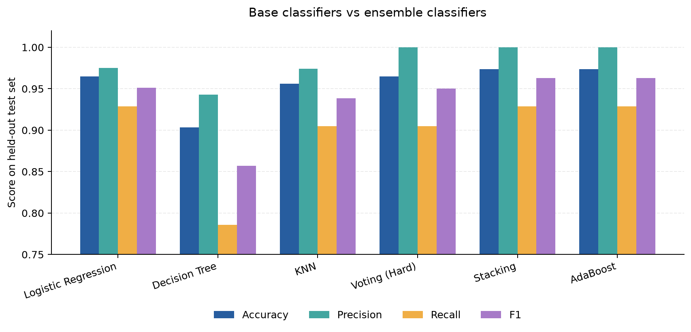

# Ensemble Learning — Practical 5

This practical compares three simple classifiers with **hard voting, stacking and AdaBoost** on the Wisconsin breast cancer dataset. I used the same train/test split for all six models to keep the comparison fair.

### What I used
- **Base models:** Logistic Regression, Decision Tree and KNN
- **Ensembles:** hard majority voting, stacking (Logistic Regression as meta-classifier) and AdaBoost (decision stumps)
- **Evaluation:** accuracy, precision, recall, F1-score, ROC-AUC, confusion matrices and 5-fold cross-validation

### Run it
```bash
pip install -r requirements.txt
python main.py
```

The data comes with `scikit-learn`, so you do not need to download a CSV. Running the script updates the charts in `outputs/` and scores in `results/`. To check the setup:

```bash
python -m unittest discover -s tests -v
```

### Results
Stacking and AdaBoost both got **97.37% accuracy** and **96.30% F1-score** on the held-out test set. Hard voting was simpler, but did not beat those two. I also looked at recall because missing a malignant case matters more than accuracy alone.

[Actual console output](results/console_output.txt)


More charts: [confusion matrices](outputs/confusion_matrices.png) · [ROC curves](outputs/roc_curves.png) · [class balance](outputs/class_balance.png)

My observations and what could be improved are in [FINDINGS.md](FINDINGS.md). The notebook is in `notebooks/` for a quick rerun.

*For coursework only; these results should not be used for medical diagnosis.*